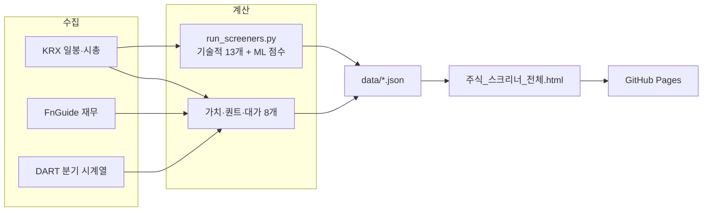

# 국내 주식 스크리너 (stock-screener-kr)

코스피·코스닥 종목을 기술적 패턴, 재무 지표, 퀀트 전략 21가지 기준으로 걸러 보여주는 스크리너입니다.
데이터 수집부터 배포까지 GitHub Actions와 GitHub Pages만으로 평일마다 자동으로 돌아갑니다.

**[사이트 바로가기 → hsh2578.github.io/stock-screener-kr](https://hsh2578.github.io/stock-screener-kr/)**

| | |
|---|---|
| **대상** | 코스피·코스닥 보통주 (스팩·리츠 제외, 재무 스크리너는 시총 1,000억 이상) |
| **스크리너** | 21개 — 기술적 13 · 가치 2 · 퀀트 2 · 투자 대가 4 |
| **ML 점수** | 3개 모델 — 박스권 돌파 · 52주 신고가 · 52주 신고가 근접 |
| **갱신** | 기술적 스크리너 평일 5회, 재무 스크리너 평일 20시 |
| **구성** | Python 수집·계산 → JSON → 단일 HTML 화면 |

## 이 저장소에서 볼 만한 것

### 1. 지표 정의를 명시한 투자 대가 스크리너

버핏·애크먼·린치·그레이엄의 투자 원칙을 재무 조건으로 옮겼습니다.
같은 "ROE > 15%"라도 분자·분모를 어떻게 잡느냐에 따라 통과 종목이 달라지므로, 지표마다 정의와 그렇게 정한 이유를 문서로 남겼습니다.

| 지표 | 정의 |
|---|---|
| PER · PBR | 시총 ÷ 지배주주 순이익(TTM), 시총 ÷ 지배주주 자본 |
| ROE | 전체 순이익(TTM) ÷ (최근 분기 + 1년 전) 평균 지배자본 |
| EPS 성장률 | 지배순이익 TTM ÷ 1년 전 TTM − 1 |
| 배당수익률 | 최근 보고서의 주당배당금 ÷ 전년 말 종가 |
| 5년 흑자 (그레이엄) | 최근 20개 분기 순이익이 전부 흑자 |
| 10년 성장률 (그레이엄) | 10년 구간의 처음 3년 평균 → 최근 3년 평균 |

- 현대글로비스의 ROE는 기말 자본 기준 15.7%, 1년 전과의 평균 자본 기준 16.56%입니다. 경계 근처 종목은 정의 하나로 포함 여부가 바뀝니다.
- 그레이엄의 10년 성장률은 정의 210가지(지표 × 기준 × 기간 × 계산식)를 실제 종목에 적용해 비교한 뒤, 원전 방식인 3년 평균 비교를 택했습니다.

구현 설명: **[docs/대가_스크리너_구현.md](docs/대가_스크리너_구현.md)**

### 2. 데이터 출처를 역할별로 결합

| 출처 | 쓰는 곳 |
|---|---|
| KRX OpenAPI · pykrx | 일봉, 시가총액 (날짜별 parquet 저장소, 수정주가 자체 계산) |
| FnGuide | 최근 분기 재무상태표, TTM 손익, 현금흐름 |
| DART 원본 (dartlab 공개 미러) | 2015년 이후 분기 이익·자본, 주당배당금 |
| WiseIndex | WICS 업종 분류 |

FnGuide는 분기 4개·연간 5년만 제공하므로 ROE 평균자본이나 10년 성장률처럼 긴 시계열이 필요한 지표는 DART 원본에서 가져옵니다.
미러에 빠진 분기 보고서는 다음 해 보고서의 전기 비교 수치로 채웁니다 (`scripts/dart_data.py`).

### 3. 사전 정보 누수를 막은 ML 학습

돌파·신고가 이벤트 뒤 20거래일 수익을 예측하는 모델 3개를 연도별 워크포워드로 평가합니다.
학습 구간과 평가 구간 사이에 30영업일 간격을 두고, 스케일러는 폴드 안에서만 맞춥니다.
이벤트는 화면에 쓰는 것과 같은 스크리너 규칙을 과거 전 기간(상장폐지 종목 포함)에 적용해 만듭니다.
자세한 내용은 [ml/README.md](ml/README.md)에 있습니다.

## 전체 흐름



| 워크플로 | 시점 (KST) | 하는 일 |
|---|---|---|
| `deploy.yml` | 평일 10·12·14·16·18시 무렵 | 기술적 스크리너 실행, 차트 데이터 생성, 배포 |
| `value-screener.yml` | 평일 20시 | 재무 수집 후 가치·퀀트·대가 스크리너 실행 |

## 스크리너 목록

조건식 전체는 [docs/스크리너_조건식_설명서.md](docs/스크리너_조건식_설명서.md)에 있습니다.

### 박스권 패턴

| 스크리너 | 조건 요약 |
|---|---|
| 박스권 횡보 | 60거래일 이상 횡보 중인 종목 |
| 박스권 돌파 (거래량) | 거래량 2배를 동반한 저항선 돌파 · ML 점수 |
| 박스권 돌파 (단순) | 거래량과 무관하게 돌파 후 10일 이내 · ML 점수 |
| 풀백 | 돌파 후 저항선까지 되돌림 |

### 추세 · 거래량

| 스크리너 | 조건 요약 |
|---|---|
| 52주 신고가 | 직전 1년 고점을 종가로 돌파, 8거래일 추적 · ML 점수 |
| 52주 신고가 근접 | 52주 고가 3% 이내, 아직 미돌파 · ML 점수 |
| 거래량 폭발 | 40일 평균 거래량 2배 + 12% 이상 상승 |
| 눌림목 | 급등 후 −4%~+2% 유지 + 거래량 급감 |
| 상승률 | 최근 5거래일 날짜별 상승률 상위 20 |
| 이평선 수렴 | 이평선 수렴 + 정배열 + 신고가 |

### 반등 · 업종

| 스크리너 | 조건 요약 |
|---|---|
| 바닥 탈출 | 150일선 돌파 + 반등 점수 7점 이상 |
| 낙폭과대 반등 | 52주 고가 −40% + 저점 상승 |
| 업종별 4단계 | 와인스타인 30주선 기준 업종 단계 분석 |

### 가치 · 퀀트

| 스크리너 | 조건 요약 |
|---|---|
| 저평가 우량주 | 매출·이익 CAGR 10% 이상이고 최근 누적 실적도 성장 |
| 60주선 우량주 | 60주선 지지 + 영업이익률·성장률 |
| 마법공식 | 이익수익률 + 유형자본 수익률 순위 합 (그린블라트) |
| 멀티팩터 | 품질 · 가치 · 모멘텀(12-1) Z-점수 |

### 투자 대가

| 스크리너 | 조건 |
|---|---|
| 워렌 버핏 | ROE > 15%, PER < 17, PBR < 1.5, 유동비율 > 1.5, 부채비율 < 150%, 장기부채비율 < 100%, FCF > 0, EPS 성장률 > 10% |
| 빌 애크먼 | ROIC > 13%, PER < 20, PBR < 2, 부채비율 > 150%, FCF > 0, 배당수익률 > 2% |
| 피터 린치 | PER < 30, 0 < PEG < 1.8, 재고/매출 < 5%, 부채비율 < 150%, ROE > 5%, ROA > 1%, 배당수익률 > 3% |
| 벤저민 그레이엄 | 기술 기업 제외, 매출 > 1,000억, 유동비율 > 200%, 순유동자산 > 장기부채, EPS 10년 성장률 > 30%, 20개 분기 연속 흑자, PER < 15, PBR×PER < 22 |

## 로컬 실행

```bash
git clone https://github.com/hsh2578/stock-screener-kr.git
cd stock-screener-kr
pip install -r requirements.txt

# 화면만 보기 (저장소에 들어 있는 최신 결과 사용)
python -m http.server 8000
# → http://localhost:8000/주식_스크리너_전체.html

# 스크리너 실행
python run_screeners.py        # 기술적 스크리너 (KRX_API_KEY 필요)
python collect_quant_data.py   # FnGuide 재무 수집 → .cache/
python guru_screeners.py       # 대가 4종
python magic_formula.py        # 마법공식
python multi_factor.py         # 멀티팩터

# 점검
python test_fnguide_parse.py   # 파싱·지표·스크리너 정의
python scripts/dart_data.py    # DART 시계열 처리
```

기술적 스크리너의 일봉 수집에는 KRX OpenAPI 키(`KRX_API_KEY`)가 필요하고, 최신 거래일 시세에는 KRX 로그인 정보(`KRX_ID`, `KRX_PW`)를 씁니다. DART 시계열은 공개 미러를 읽으므로 키가 필요 없습니다.

## 저장소 구조

```
stock-screener-kr/
├── 주식_스크리너_전체.html     화면 (CSS·JS 포함 단일 파일)
├── run_screeners.py           기술적 스크리너 13개 + ML 점수
├── collect_quant_data.py      FnGuide 재무 수집 (재무 스크리너 공용 캐시)
├── guru_screeners.py          투자 대가 4종
├── magic_formula.py · multi_factor.py · test_value_screener.py · ma60w_quality.py
├── scripts/
│   ├── ohlcv_store.py         날짜별 일봉 저장소, 수정주가 계산
│   ├── fnguide_data.py        재무 수집과 지표 계산 함수
│   ├── dart_data.py           DART 분기 시계열·배당
│   ├── screeners/             기술적 스크리너 모듈
│   └── utils/
├── ml/                        이벤트 생성, 워크포워드 학습, 모델 (ml/README.md)
│   └── experiments/           초기 모델 비교 실험 스크립트 (보관용)
├── data/                      스크리너 결과 JSON (화면이 읽는 파일)
├── docs/                      조건식 설명서, 대가 스크리너 구현 설명
└── .github/workflows/         자동 실행·배포
```

## 한계

- 스크리너는 조건에 맞는 종목을 보여줄 뿐이고 수익률을 보장하지 않습니다. 대가 스크리너의 전략 수익률은 검증하지 않았습니다.
- ML 점수의 확률은 보정되지 않았습니다. 절대값보다 순위로 읽어야 합니다.
- 재무 데이터는 제공처의 반영 시점에 따라 종목별로 한 분기 늦을 수 있습니다.
- 애크먼 전략의 ROIC는 `영업이익(TTM) ÷ 유형 투하자본`입니다. 자산이 가벼운 기업은 높게 나오므로 유형 투하자본이 총자산의 10% 미만이면 제외합니다.

## 면책 조항

본 서비스는 개인 학습·연구 목적의 화면이며 투자 권유나 매매 추천이 아닙니다. 조건식과 모델 점수는 과거 데이터에 근거한 것으로 미래 수익을 보장하지 않고, 투자 판단의 책임은 본인에게 있습니다.

시세·재무 데이터의 권리는 각 제공처(KRX, FnGuide, DART 등)에 있습니다. DART 분기 시계열은 [dartlab](https://github.com/eddmpython/dartlab) 공개 데이터셋(CC BY 4.0)을 사용합니다.

## 관련 저장소

- [ai-stock-screener](https://github.com/hsh2578/ai-stock-screener) — 52주 신고가 돌파 모델의 초기 실험
- [kr-52w-high-overnight-study](https://github.com/hsh2578/kr-52w-high-overnight-study) — 신고가 돌파 종목의 익일 시가 수익률 검증
