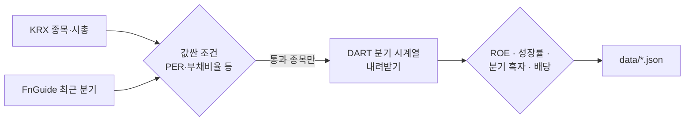

# 투자 대가 스크리너 구현

버핏·애크먼·린치·그레이엄의 투자 원칙을 재무 조건으로 옮긴 스크리너 4종의 구현 설명입니다.
조건 자체보다 **지표를 어떻게 계산하느냐**가 결과를 좌우하므로, 각 지표의 정의와 그렇게 정한 이유를 적었습니다.

- 대상: 코스피·코스닥 시총 1,000억 이상 보통주 (스팩·리츠 제외)
- 실행: 평일 20시 GitHub Actions (`value-screener.yml`)
- 코드: [`guru_screeners.py`](../guru_screeners.py), [`scripts/dart_data.py`](../scripts/dart_data.py), [`scripts/fnguide_data.py`](../scripts/fnguide_data.py)

## 1. 조건

| 전략 | 조건 | 정렬 |
|---|---|---|
| 워렌 버핏 | ROE > 15%, PER < 17, PBR < 1.5, 유동비율 > 1.5, 부채비율 < 150%, 장기부채비율 < 100%, FCF > 0, EPS 성장률 > 10% | FCF 큰 순 |
| 빌 애크먼 | ROIC > 13%, PER < 20, PBR < 2, 부채비율 > 150%, FCF > 0, 배당수익률 > 2% | ROIC 높은 순 |
| 피터 린치 | PER < 30, 0 < PEG < 1.8, 재고/매출 < 5%, 부채비율 < 150%, ROE > 5%, ROA > 1%, 배당수익률 > 3% | PEG 낮은 순 |
| 벤저민 그레이엄 | 기술 기업 제외, 매출 > 1,000억, 유동비율 > 200%, 순유동자산 > 장기부채, EPS 10년 성장률 > 30%, 20개 분기 연속 흑자, PER < 15, PBR×PER < 22 | PER×PBR 낮은 순 |

## 2. 지표 정의

같은 이름의 지표도 정의가 다르면 다른 종목을 고릅니다. 모든 손익 지표는 TTM(최근 4분기 누적)으로 통일했습니다.

| 지표 | 정의 | 이렇게 정한 이유 |
|---|---|---|
| PER | 시총 ÷ 지배주주 순이익(TTM) | 주주에게 귀속되는 이익만 본다. 자회사 비지배 지분이 큰 지주사의 PER이 낮게 왜곡되는 것을 막는다 |
| PBR | 시총 ÷ 지배주주 자본 | PER과 같은 기준 |
| ROE | 전체 순이익(TTM) ÷ (최근 분기 + 1년 전) 평균 지배자본 | 이익은 1년 동안 벌었으므로 분모도 그 기간의 평균 자본이어야 한다. 기말 자본만 쓰면 증자·대규모 이익이 있던 종목이 낮게 나온다 |
| ROA | 전체 순이익(TTM) ÷ (최근 분기 + 1년 전) 평균 자산 | ROE와 같은 기준 |
| EPS 성장률 | 지배순이익 TTM ÷ 1년 전 TTM − 1 | 연간 실적을 기다리지 않고 최근 분기까지 반영한다. 분기 단독 비교보다 계절성 영향이 작다 |
| PEG | PER ÷ EPS 성장률 | 성장률이 0 이하이면 계산하지 않는다 |
| 재고 / 매출 | 재고자산(4분기 평균) ÷ 매출(TTM) | 분기 말 일시적 재고 변동을 완화한다 |
| FCF | 영업현금흐름(TTM) − 유형·무형자산 취득(TTM) | 투자활동현금흐름 전체를 빼면 단기금융상품 매매가 섞인다 |
| 배당수익률 | 최근 보고서의 주당배당금 ÷ 전년 말 종가 | 현재가로 나누면 주가가 급락한 종목의 배당 매력이 과대평가된다 |
| ROIC | 영업이익(TTM) ÷ 유형 투하자본 | 순운전자본 + 유형자산 (그린블라트 방식). 마법공식 스크리너와 같은 정의 |
| 부채비율 | 부채총계 ÷ 자본총계 | |
| 장기부채비율 | 비유동부채 ÷ 지배주주 자본 | |

### 정의 하나로 달라지는 값

현대글로비스의 2026년 3분기 기준 ROE는 분모에 따라 이렇게 달라집니다.

| 분모 | ROE |
|---|---:|
| 기말 지배자본 | 15.7% |
| 4분기 평균 지배자본 | 16.2% |
| 최근 분기와 1년 전의 평균 지배자본 | 16.56% |

조건이 "ROE > 15%"이면 경계 근처 종목은 이 차이만으로 포함 여부가 바뀝니다.

## 3. 그레이엄 전략의 두 가지 판단

### 최근 5년 흑자 → 20개 분기 연속 흑자

연간 합계가 흑자여도 중간에 적자 분기가 있는 회사가 있습니다.
방어적 투자자 기준의 취지는 이익의 꾸준함이므로, 연 단위 대신 분기 단위로 확인합니다.
분기값은 `당해 누적 − 직전 분기 누적`으로 구하고, 확인할 수 있는 분기가 16개에 못 미치면 판단할 수 없는 종목으로 보고 제외합니다.

### EPS 10년 성장률 → 3년 평균끼리 비교

10년 전과 지금을 한 해씩만 비교하면 시작점이나 끝점이 우연히 호황·불황이었던 종목의 성장률이 크게 왜곡됩니다.
대륙제관의 연간 EPS(원)가 좋은 예입니다.

| 2016 | 2017 | 2018 | 2019 | 2020 | 2021 | 2022 | 2023 | 2024 | 2025 |
|---:|---:|---:|---:|---:|---:|---:|---:|---:|---:|
| 912 | 605 | 228 | 337 | 757 | 478 | 610 | 822 | 724 | 577 |

2016년과 2025년만 비교하면 −37%이지만, 처음 3년 평균(582)과 최근 3년 평균(708)을 비교하면 +22%입니다.
그레이엄은 『현명한 투자자』 14장에서 10년 구간의 처음 3년 평균과 마지막 3년 평균을 비교하도록 했습니다.
이 스크리너는 같은 방식으로, 매년 같은 분기 시점의 TTM 지배순이익을 10년치 늘어놓고 가장 오래된 3개 평균과 최근 3개 평균을 비교합니다.

성장률 정의를 고를 때는 지표(지배순이익·EPS), 기준(연간·TTM·단일 분기), 기간(5~10년), 계산식(끝점 비교·3년 평균 비교·증가율 합 등 7가지)을 조합한 210가지를 실제 종목에 적용해 결과가 어떻게 달라지는지 비교했습니다.

## 4. 데이터

| 출처 | 쓰는 곳 | 이유 |
|---|---|---|
| FnGuide | 최근 분기 재무상태표, TTM 손익, 현금흐름 | 최신 분기 반영이 빠르고 계정이 표준화돼 있다 |
| DART 원본 ([dartlab](https://github.com/eddmpython/dartlab) 공개 미러) | 1년 전 자본·자산, 전년 TTM 이익, 2015년 이후 분기 이익, 주당배당금 | FnGuide는 분기 4개·연간 5년만 제공한다. ROE 평균자본과 10년 성장률에는 더 긴 시계열이 필요하다 |
| KRX 일봉 | 시가총액, 전년 말 종가 | 배당수익률의 분모 |



### 구현하면서 처리한 문제

- **누락 보고서 보충.** 공개 미러에 일부 분기 보고서가 빠진 종목이 있어 ROE와 성장률을 계산할 수 없었습니다. 보고서에는 전기 비교 수치가 함께 실리므로, 다음 해 보고서의 전기 칸으로 빈 분기를 채웁니다 (손익은 전년 동기, 재무상태는 전년 말). 1년 전 분기의 자본이 끝내 없으면 그 앞뒤 분기 값으로 대체합니다.
- **누적값 오독 방지.** 분기 보고서의 손익은 3개월치와 누적치가 따로 있습니다. 누적 칸이 비어 있을 때 3개월치로 대체하는 것은 두 값이 같은 1분기에만 허용합니다. 2·3분기에 그렇게 하면 TTM이 틀어집니다.
- **지배 지분 태그가 없는 회사.** 지배주주 순이익·자본을 따로 공시하지 않는 회사는 전체에서 비지배 지분을 빼서 구합니다.
- **외화 공시 제외.** 달러·위안으로 공시하는 회사는 원화 시총과 섞으면 비율이 깨지므로 제외합니다.
- **내려받기 최소화.** PER, 부채비율처럼 이미 가진 데이터로 판정할 수 있는 조건을 먼저 적용하고, 통과한 종목만 DART 시계열을 받습니다. 받은 파일은 7일간 캐시합니다.

### 점검

```bash
python scripts/dart_data.py     # 누적·분기 처리, 누락 보충, TTM, 성장률, 배당 파싱
python test_fnguide_parse.py    # 재무 파싱과 지표 계산
```

두 스크립트 모두 외부 접속 없이 고정된 입력으로 계산 결과를 확인합니다.

## 5. 한계

- **수익률은 검증하지 않았습니다.** 이 스크리너는 조건에 맞는 종목을 보여줄 뿐입니다.
- **데이터 반영 시점.** 제공처에 따라 종목별로 최신 분기 반영이 한 분기 늦을 수 있습니다.
- **EPS 성장률의 변동성.** TTM 전년 대비 성장률은 이익이 급증한 해에 수백 %가 나올 수 있고, 그러면 PEG가 0에 가깝게 떨어집니다. 린치 전략 결과를 볼 때 성장률 열을 함께 확인해야 합니다.
- **ROIC 정의.** 유형 투하자본이 작은 자산 경량 기업은 ROIC가 높게 나옵니다. 유형 투하자본이 총자산의 10%에 못 미치는 종목은 계산에서 제외합니다.
- **12월 결산 가정.** 배당수익률의 분모로 12월 말 종가를 쓰므로 3·6·9월 결산 법인은 결산월 종가와 차이가 있습니다.
